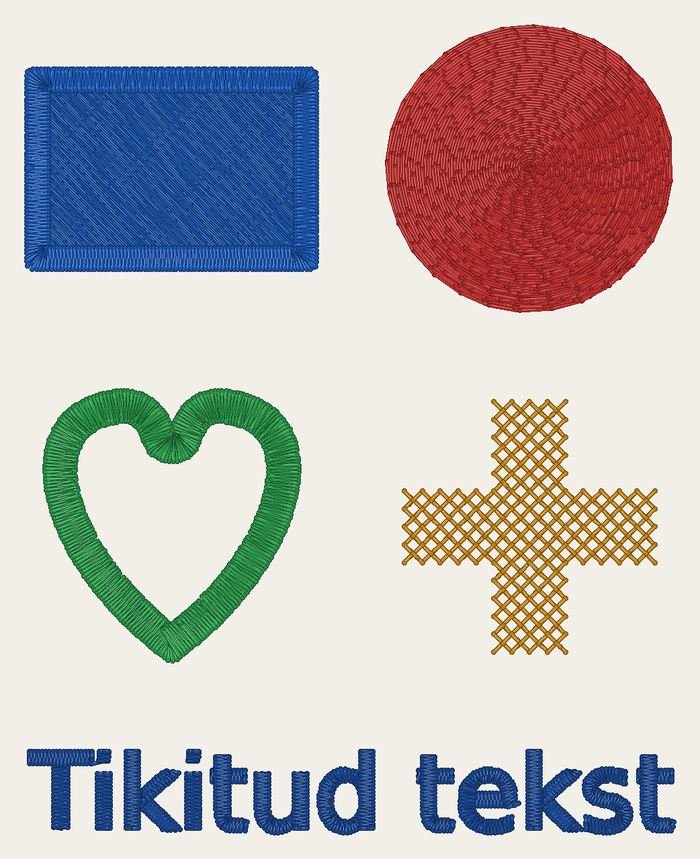
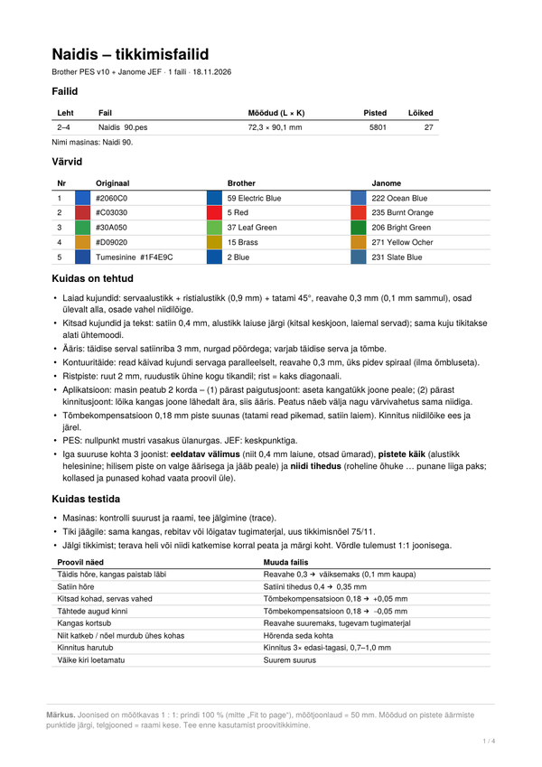
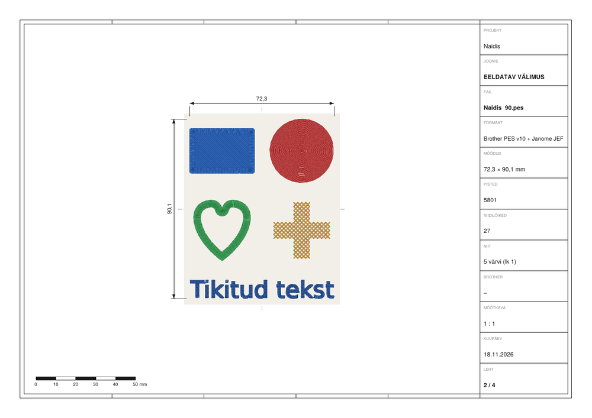
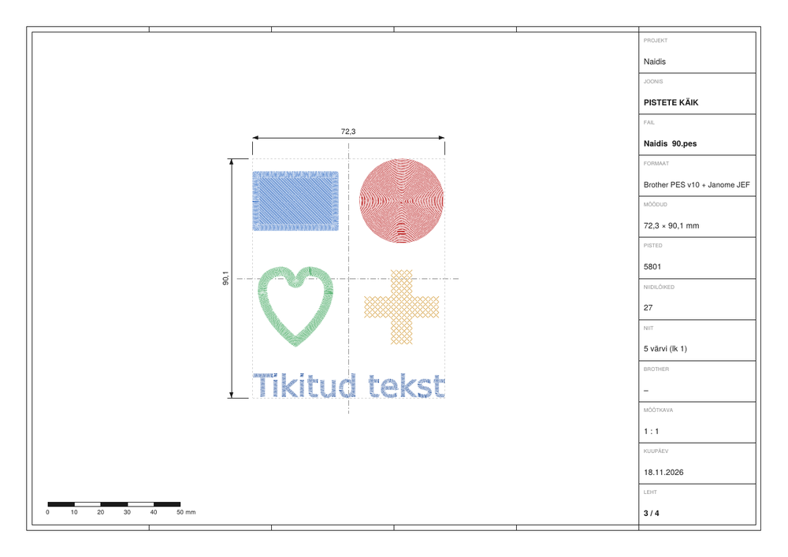
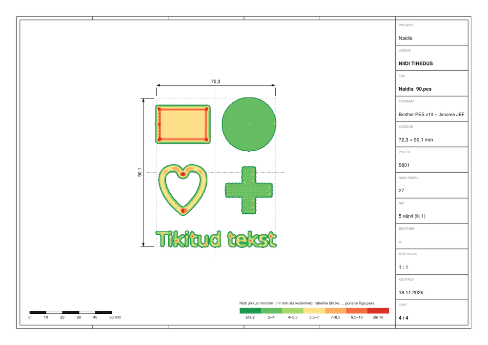

# STITCH-O-MATIC

Claude teeb pildist masintikandi faili. Sina annad pildi ja ütled, mis masin, mis suurused ja mis kangas. Tagasi saad failid, mille saab otse masinasse laadida, ja projekti-PDF-i, kus on kogu info ühes kohas.

## Mida see oskab

- **Tekst ja kitsad kujundid** satiinis: nurgad, ristumised ja tähtede kõhud tulevad ühtlased.
- **Laiad alad** täidisena, soovi korral satiinäärisega.
- **Ümarad kujundid** kontuuritäitena, mis paistab kumer.
- **Aplikatsioon:** suur ala tehakse kangatükist. Masin peatub ja PDF ütleb, mida peatuse ajal teha.
- **Ristpiste** folk- ja ruutmustritele.
- **Mitu värvi ja mitu suurust** korraga, kõik suurused tikitakse ühtemoodi.
- **Kanga järgi seaded:** linane, puuvill, teksas, trikoo, fliis, frotee, nahk jt. Venival kangal (trikoo, fliis) sõltub kompensatsioon pistete suunast.
- **Kontroll enne andmist:** iga fail kontrollitakse, et pisted kataks kujundi täielikult ja ükski piste ei ulatuks serva taha. Praod, kiilud, augud ja üle serva minevad tipud leitakse koos asukohaga.
- **Täpne suurus:** soovi korral tuleb tikandi tegelik mõõt täpselt soovitud suurusega; variant (nt ilma tekstita) samas mõõtkavas kui terve logo.
- **Väike kiri peene niidiga** (60 wt): tähtede augud jäävad lahti.
- **Foto võrdlus:** tikitud tulemuse foto võrreldakse failiga ja näidatakse, kus kangas tõmbas sisse või kuju venis.

Claude pakub iga kujundi juures sobiva tehnika välja ja ütleb, miks. Otsuse teed sina.



*Näidis 72 × 90 mm: täidis äärisega, kontuuritäide, aplikatsioon, ristpiste ja tekst.*

## Mida saad

- **Tikkimisfailid** iga suuruse kohta: Brother Innov-is V3 (PES) ja/või Janome Memory Craft 550E (JEF).
- **Projekti-PDF:** failid, niidivärvid (Brother ja Janome), kuidas on tikitud, kuidas testida ja iga suuruse joonised mõõtkavas 1 : 1. Joonistel on eeldatav välimus, pistete käik ja koht, kus niit võib liiga paksuks minna.

### PDF lehed



*Esileht.* Siin on failide nimekiri koos mõõtude, pistete ja niidilõigete arvuga ning värvitabel: originaalvärv ja lähim Brotheri ja Janome niit. Lisaks lühidalt, kuidas on tikitud (tehnikad, tihedus, aplikatsiooni peatused), kuidas testida ja mida muuta, kui proovil midagi ei sobi.



*Eeldatav välimus.* Nii peaks tikand pärast tikkimist välja nägema: kangas on satiini otsad sisse tõmmanud (failis on need selle võrra pikemad), niidi värvis ja paksuses, kanga tekstuuriga. Mõõtkava on 1 : 1, nii et prinditud lehte saab kanga peale panna ja võrrelda. Paremal on pealkirjaplokk (fail, mõõdud, pisted, niidilõiked), all mõõtjoonlaud.



*Pistete käik.* Iga piste on joonena näha tikkimise järjekorras. Helesinine peenike joon on alustikk, mis jääb pealmise niidi alla. Hilisem piste on valge äärisega ja jääb peale. Siit on näha iga kujundi piste suund.



*Niidi tihedus.* Näitab, kui palju niiti on igas kohas. Roheline on õhuke, kollane tavaline tihe satiin, oranž ja punane paks. Punased kohad (siin äärise nurgad, südame tipp ja lohk) tasub proovil üle vaadata: seal võib nõel kuumeneda või niit katkeda.

## Paigaldamine

Kopeeri see käsk Claude'ile või oma agendile:

```
Paigalda kratt.roots.ee/skill.md – STITCH-O-MATIC
```

Ta juhendab sind edasi samm-sammult. Vaata ka [kratt.roots.ee](https://kratt.roots.ee).

## Kuidas käib

1. Claude küsib masina, suurused, kanga ja niidid. Kui midagi pole selge, küsib ta, mitte ei oleta.
2. Claude pakub tehnikad välja ja sina kinnitad.
3. Claude teeb failid ja kontrollib need üle: mõõdud, raam, pistete pikkus ja tihedus.
4. Sina saad failid ja PDF-i ning teed proovitikandi samale kangale.
5. Kui proovil midagi ei meeldi, ütle. Claude parandab ja teeb kõik suurused uuesti.

## Piirangud

- Parim on vektorpilt (SVG). Foto või PNG tuleb enne vektoriks teha.
- Tulemus on arvutatud, mitte tikitud. Proovitikand on alati vajalik.
- Väga paks kiri väikeses suuruses tuleb veel ebaühtlane. Sel juhul tee kiri suuremaks või vali õhem kiri.
- Mida veel ei oska (nt 3D vaht, pits, mitmes raamis tikand): `TODO.md`.
